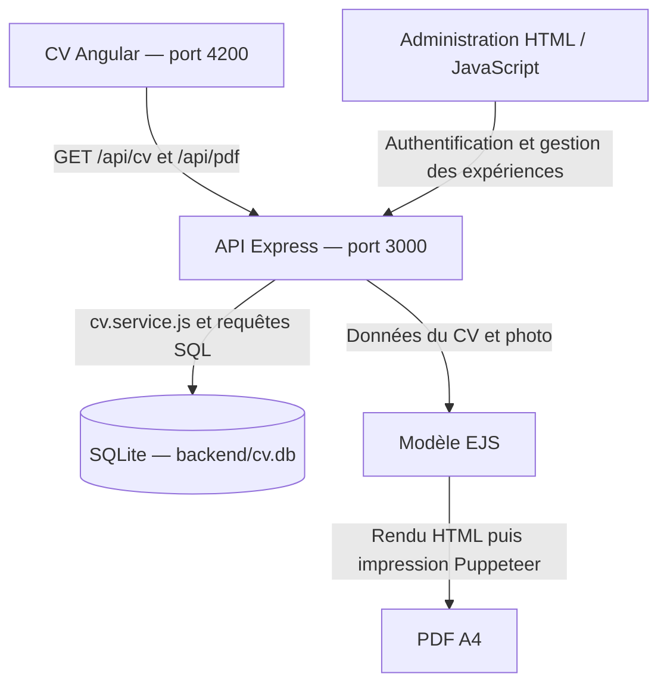

# CV de Yassine Hannachi — Développeur Full-Stack Java / Angular

Application personnelle destinée à présenter mon parcours, mes compétences et mes expériences aux recruteurs. Le CV est consultable dans une interface web et téléchargeable en PDF, à partir des mêmes données professionnelles stockées dans SQLite.

Ce projet illustre l'intégration d'un frontend Angular avec une API Express, la modélisation relationnelle d'un CV et la génération de documents côté serveur. Mon profil professionnel est orienté Java / Spring Boot et Angular ; le backend de **cette application** est développé en Node.js / Express.

**État du projet :** le fonctionnement local est documenté ci-dessous. Aucun déploiement public fonctionnel n'est confirmé. Les URL d'API sont actuellement fixées à `http://localhost:3000`.

## Fonctionnalités

- Présentation du profil, des coordonnées, des compétences par catégorie et des expériences professionnelles.
- Affichage des missions, environnements techniques et sous-projets, ainsi que des formations, langues, certificats et centres d'intérêt.
- Interface adaptée aux écrans de bureau et mobiles avec CSS / SCSS.
- Téléchargement d'un CV PDF généré à la demande avec les données SQLite.
- Interface d'administration distincte pour consulter, créer, modifier et supprimer les expériences ; leurs sous-projets sont éditables en JSON.
- Authentification de l'administration par mot de passe haché avec bcrypt et jeton JWT valable une heure.

L'administration actuelle porte sur les expériences. Elle ne constitue pas un éditeur de toutes les rubriques du CV.

## Architecture



Le frontend est servi par Angular CLI en développement. Express expose l'API et sert les fichiers de `backend/public/`, dont l'administration ; il ne sert pas actuellement le build Angular.

| Élément | Rôle |
| --- | --- |
| `src/app/cv/` | Composant Angular standalone, affichage du CV et téléchargement du PDF |
| `src/app/app.module.ts` | Module racine intégrant le composant CV |
| `angular.json` | Configurations de développement, production et tests |
| `backend/server.js` | Serveur Express, routes publiques et génération PDF |
| `backend/cv.service.js` | Lecture de SQLite et assemblage des données du CV |
| `backend/db.js` | Ouverture de la base, création du schéma et activation des clés étrangères |
| `backend/auth.js` | Connexion et vérification des JWT |
| `backend/admin-experiences.routes.js` | API d'administration des expériences |
| `backend/public/admin/index.html` | Interface d'administration indépendante d'Angular |
| `backend/template.ejs` | Mise en page HTML utilisée pour le PDF |
| `backend/data.json`, `backend/migrate-from-data.js` | Source et script de réinitialisation des données |

## Technologies utilisées

Versions résolues dans les fichiers `package-lock.json` du dépôt :

| Couche | Technologies |
| --- | --- |
| Frontend | Angular 16.2.12, Angular CLI 16.2.16, TypeScript 4.9.5, RxJS 7.8.2, HTML, CSS / SCSS |
| API | Node.js, Express 4.21.2, middleware CORS |
| Persistance | SQLite, pilote `sqlite3` 5.1.7 |
| Génération PDF | EJS 3.1.10, Puppeteer 21.11.0 |
| Authentification | bcrypt 5.1.1, jsonwebtoken 9.0.2 |
| Tests présents | Jasmine / Karma et Cypress 10.11.0 ; scénarios hérités à adapter au CV |

Le nom technique `angular-quickstart` subsiste dans les configurations et explique le nom du dossier de compilation. Il n'identifie pas le contenu fonctionnel de l'application.

## Prérequis

- Git et npm, ainsi qu'une version de Node.js compatible avec les dépendances.
- Pour reproduire la chaîne Angular 16.2 : **Node.js 18.x à partir de 18.10**, dans la plage historique indiquée par la [matrice de compatibilité Angular](https://angular.dev/reference/versions). Cette version d'Angular est désormais hors support ; ce prérequis local ne constitue pas une recommandation pour un nouveau déploiement.
- Accès réseau pendant l'installation : paquets npm, binaires natifs éventuels et navigateur téléchargé par Puppeteer.
- Chrome pour les tests Karma ; sous Linux, les bibliothèques système nécessaires au navigateur utilisé par Puppeteer.
- Selon la plateforme, Python et les outils de compilation C / C++ si `sqlite3` ou bcrypt doivent être compilés au lieu d'utiliser un binaire précompilé.
- Ports `4200` et `3000` disponibles et droits d'écriture sur `backend/cv.db`.

SQLite est embarqué : aucun serveur de base de données séparé n'est nécessaire. Une installation globale d'Angular CLI n'est pas requise.

## Démarrer en local

### 1. Récupérer le projet et installer les dépendances

```bash
git clone https://github.com/HanachiYassine/hanachi-yassine-cv.git
cd hanachi-yassine-cv
npm ci
cd backend
npm ci
cd ..
```

Les deux applications disposent de leur propre manifeste et fichier de verrouillage. `npm ci` installe les versions verrouillées. Réinstaller les dépendances du backend est nécessaire même si son dossier `node_modules` est présent dans le dépôt : les modules natifs dépendent de la plateforme et de la version de Node.js utilisée lors de l'installation.

L'installation du backend télécharge normalement le navigateur utilisé par Puppeteer. La sauter sans fournir un navigateur compatible empêche la génération PDF de fonctionner.

### 2. Lancer le backend — terminal 1

Depuis la racine du dépôt, exemple **Bash** :

```bash
cd backend
export JWT_SECRET="$(node -p "require('crypto').randomBytes(32).toString('hex')")"
npm start
```

Conserver la même valeur de `JWT_SECRET` entre les redémarrages si les jetons existants doivent rester valables. Sous PowerShell, définir cette variable avec `$env:JWT_SECRET` avant `npm start`.

L'API écoute sur [http://localhost:3000](http://localhost:3000). Le port est fixé dans `server.js` ; aucune variable `PORT` n'y est lue. Le code prévoit une clé JWT de repli : définir explicitement `JWT_SECRET` pour l'administration.

### 3. Lancer le frontend — terminal 2

Depuis la racine du dépôt :

```bash
npm start
```

Ouvrir [http://localhost:4200](http://localhost:4200). Le script lance `ng serve` avec la configuration de développement. Le backend doit être démarré pour charger le CV et produire le PDF.

### 4. Accéder à l'administration

Ouvrir [http://localhost:3000/admin/](http://localhost:3000/admin/). La connexion nécessite un utilisateur existant dans la table `users`. Il n'existe pas d'endpoint d'inscription ; la création d'un compte par le script d'import est décrite plus bas.

## API HTTP

### Routes publiques

| Méthode | Route | Réponse |
| --- | --- | --- |
| GET | `/api/cv` | `200` : objet JSON avec `infos`, `profil`, `competences`, `experiences`, `formation`, `langues`, `certificats`, `centresInteret` |
| GET | `/api/pdf` | `200` : contenu binaire `application/pdf` généré à la demande |

Les expériences sont lues dans l'ordre du champ SQLite `ordre`. Le service rattache les missions, technologies et éventuels sous-projets à chaque expérience. Les compétences sont regroupées par catégorie.

Les deux routes retournent `500` en cas d'erreur de lecture ou de génération. Vérifications manuelles, avec le backend démarré :

```bash
curl --fail http://localhost:3000/api/cv
curl --fail http://localhost:3000/api/pdf --output cv.pdf
```

### Authentification et administration

`POST /api/admin/login` reçoit un JSON avec `email` et `password`. Il retourne `200` avec `{ "token": "…" }` après vérification bcrypt ; `400` si les champs manquent, `401` si les identifiants sont incorrects, `500` en cas d'erreur interne.

Les routes suivantes nécessitent l'en-tête `Authorization: Bearer <token>` :

| Méthode | Route | Comportement nominal |
| --- | --- | --- |
| GET | `/api/admin/experiences` | `200` : liste des expériences, sans leurs collections de détails |
| GET | `/api/admin/experiences/:id` | `200` : expérience avec missions, technologies et sous-projets ; `404` si absente |
| POST | `/api/admin/experiences` | `201` : création et retour de l'identifiant |
| PUT | `/api/admin/experiences/:id` | `200` : mise à jour des champs et remplacement des collections de détails |
| DELETE | `/api/admin/experiences/:id` | `200` : suppression ; les détails associés sont supprimés par cascade |

Un jeton absent entraîne `401`, un jeton invalide ou expiré `403`. Les erreurs SQL sont traitées avec une réponse `500` dans les gestionnaires concernés.

Les corps POST / PUT utilisent `poste`, `entreprise`, `localisation`, `periode`, `projet`, `client`, `equipe`, `role`, `missions`, `technologies` et `projets`. Chaque sous-projet contient `titre`, `contexte`, `missions` et `technologies`. Les contraintes SQLite imposent notamment `poste`, `entreprise` et `periode` non nuls ; aucune validation métier complète des corps JSON n'est implémentée.

Le PUT remplace les missions, technologies et sous-projets : transmettre les collections à conserver. Les routes PUT / DELETE ne vérifient pas explicitement l'existence de l'identifiant avant de répondre.

## Génération du PDF

1. `GET /api/pdf` relit les données avec `cv.service.js`.
2. Le serveur lit `src/assets/cv-profile.jpeg` et l'intègre en base64 si le fichier existe.
3. EJS produit le HTML à partir de `backend/template.ejs`.
4. Puppeteer démarre un navigateur sans interface, charge le HTML et imprime un PDF A4 avec les arrière-plans et des marges nulles.
5. Le PDF est renvoyé directement. Le composant Angular le télécharge avec un nom horodaté.

Le PDF est généré côté serveur à chaque demande ; il ne provient pas du fichier PDF statique présent dans `src/assets/`. Le modèle EJS possède sa propre mise en page : modifier le SCSS Angular ne modifie pas automatiquement le PDF. Si la photo manque, le serveur poursuit le rendu sans elle.

## Base SQLite et données

`backend/db.js` ouvre **`backend/cv.db`**, à un chemin relatif au fichier du module, et crée les tables manquantes avec `CREATE TABLE IF NOT EXISTS`. Le dépôt contient déjà une base renseignée. Le démarrage crée le schéma mais n'importe pas automatiquement `data.json`.

Au démarrage, `backend/migrations/20261010-align-cv-aptineo.sql` synchronise une seule fois les données professionnelles de la base fournie avec le CV Aptineo du 6 octobre 2026. Cette migration conserve les identifiants des expériences et sous-projets, les coordonnées personnelles et les comptes d'administration. La table technique `cv_data_migrations` enregistre son application ; les modifications effectuées ensuite depuis l'administration sont conservées aux redémarrages. Le contrôle des identifiants et de l'ordre des expériences limite cette migration à la base prévue par le dépôt.

| Tables | Contenu |
| --- | --- |
| `infos`, `profil` | Informations générales et présentation, chacune sur la ligne `id = 1` |
| `competences` | Compétences regroupées par catégorie |
| `experiences`, `experience_missions`, `experience_technos` | Expériences, missions et technologies |
| `experience_projets`, `experience_projet_missions`, `experience_projet_technos` | Sous-projets et leurs détails |
| `formations`, `langues`, `certificats`, `centres_interet` | Autres rubriques du CV |
| `users` | Comptes d'administration avec mot de passe haché |

Les clés étrangères sont activées ; les relations de détails utilisent `ON DELETE CASCADE`. Les données SQLite alimentent l'écran CV et l'export PDF. Modifier uniquement `data.json` ne change pas le CV servi.

### Réinitialisation facultative depuis data.json

**Cette opération efface les données du CV et les utilisateurs existants**, puis les recrée depuis `backend/data.json`. Elle n'est pas nécessaire au démarrage avec la base fournie et ne réalise pas une migration incrémentale.

Arrêter le backend et sauvegarder `cv.db` avant toute réinitialisation. Exemple Bash, exécuté depuis la racine :

```bash
cd backend
cp cv.db cv.db.backup
export ADMIN_EMAIL="admin@example.com"
read -r -s -p "Mot de passe du nouveau compte : " ADMIN_PASSWORD
export ADMIN_PASSWORD
node migrate-from-data.js
unset ADMIN_PASSWORD
```

Définir les deux variables pour éviter les identifiants de repli du script. **Le script actuel affiche le mot de passe dans ses logs** : exécuter cette opération localement sans partager sa sortie. Les scripts `update-profile.js` et `update-technos.js` sont des modifications ponctuelles des données, pas des prérequis au lancement.

## Compilation et tests

Commandes à exécuter depuis la racine, après installation :

| Commande | Usage |
| --- | --- |
| `npm run build -- --configuration development` | Compilation de développement |
| `npm run build` | Compilation de production, configuration par défaut |
| `npm run build -- --configuration production` | Compilation de production explicite |
| `npm run watch` | Compilation continue en développement |
| `npm test` | Tests Jasmine / Karma avec Chrome, en mode surveillance |
| `npm test -- --watch=false --browsers=ChromeHeadless` | Tests unitaires sans surveillance |
| `npx cypress run --config baseUrl=http://localhost:4200` | Tests E2E, avec frontend et backend démarrés |

Le build Angular est écrit dans `dist/angular-quickstart/`. Le backend JavaScript s'exécute avec `npm start` dans `backend/` ; il ne définit ni script de compilation ni script de test.

**Vérification du 10 octobre 2026 :**

| Vérification | Résultat observé |
| --- | --- |
| Installation frontend | Réussie avec `npm ci --ignore-scripts` ; les scripts d'installation n'ont pas été exécutés |
| Installation backend | Réussie avec `PUPPETEER_SKIP_DOWNLOAD=true npm ci` sous Node.js 24.19.0 ; le téléchargement du navigateur n'a pas été validé par cette commande |
| Build de développement | Réussi sous Node.js 18.20.8 |
| Build de production | Échec sur le budget de `cv.component.scss` : 4,22 Ko générés pour une limite de 4 Ko dans `angular.json` |
| Jasmine / Karma | Compilation réussie, puis arrêt faute de binaire Chrome configuré ; aucun test exécuté dans un navigateur |
| API et administration | Sous Node.js 24.19.0, sur une copie de la base : `GET /api/cv` et `/admin/` répondent `200` ; absence de jeton `401`, jeton invalide `403`, connexion incomplète `400`, identifiants incorrects `401` |
| Export PDF | Route appelée ; réponse `500` car le lancement du navigateur est bloqué par les restrictions de l'environnement d'exécution ; PDF non validé |

Les commandes d'installation et leurs scripts ont été confrontés aux manifestes et fichiers de verrouillage. Ces résultats ne certifient pas une installation complète avec les téléchargements de navigateurs, ni une compatibilité du frontend Angular 16 avec Node.js 24. Les données et le code applicatif n'ont pas été modifiés par cette vérification.

**Limites des tests existants :** `app.component.spec.ts` attend encore le titre du modèle initial et ne configure pas le composant CV dans son module de test. Les scénarios Cypress attendent eux aussi l'ancien écran. Leur `baseUrl` configurée est `localhost:8888` ; la commande ci-dessus l'adapte au port Angular. Ces tests ne constituent pas actuellement une validation complète du CV ou du PDF et leur réussite n'est pas annoncée.

## Préparer un déploiement distant

Aucune URL publique fonctionnelle n'est annoncée. Un build de production ne suffit pas à rendre cette application accessible :

- Configurer les URL d'API dans `src/app/cv/cv.component.ts` et `backend/public/admin/index.html`, actuellement fixées à `localhost:3000`. Les fichiers `environment*.ts` ne définissent pas d'URL d'API.
- Héberger séparément le frontend compilé et le serveur Node.js, ou configurer explicitement leur exposition commune.
- Prévoir un stockage persistant et accessible en écriture pour SQLite, ainsi que ses sauvegardes.
- Installer le navigateur et les bibliothèques système nécessaires à Puppeteer sur le serveur.
- Définir un secret JWT, des identifiants d'administration propres à l'environnement, HTTPS et des origines CORS adaptées ; le serveur autorise actuellement toutes les origines.
- Revoir les options de lancement du navigateur, qui désactivent actuellement sa sandbox, et moderniser les dépendances avant une exposition publique.

Ces points décrivent le travail nécessaire ; ils ne signifient pas qu'il a déjà été réalisé.

## Auteur

**Yassine Hannachi — Développeur Full-Stack Java / Spring Boot / Angular**

Ce dépôt présente une réalisation personnelle couvrant l'interface web, une API HTTP, la persistance des données, l'authentification d'un espace d'administration et la génération PDF. Le code et les instructions locales permettent d'en examiner concrètement les choix techniques.

[Profil GitHub](https://github.com/HanachiYassine)
